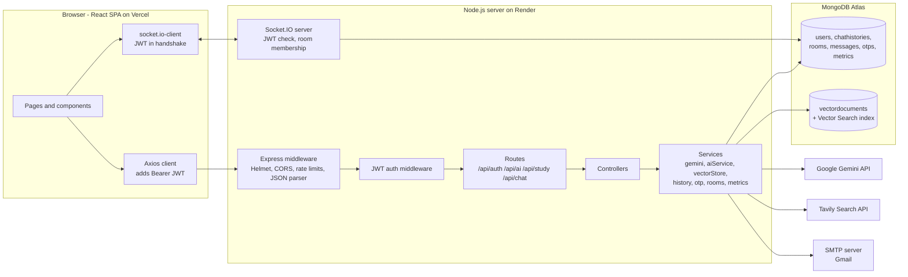
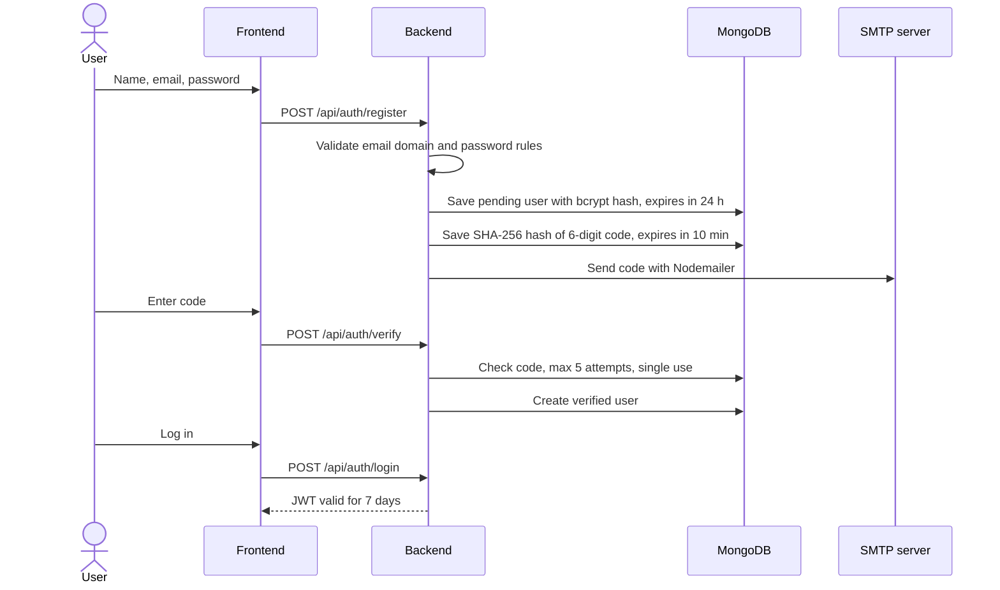
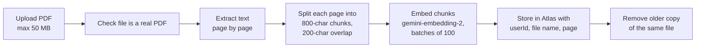
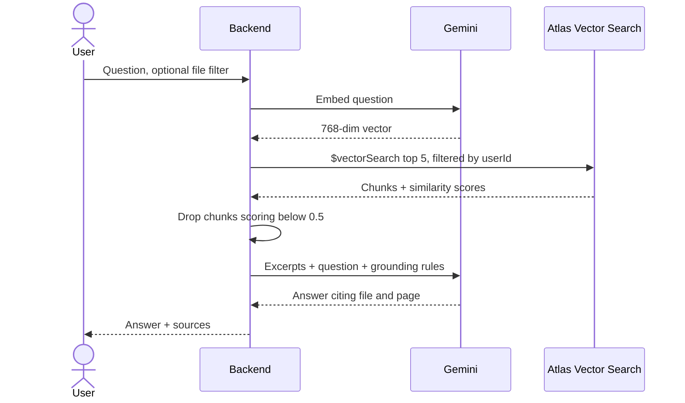

# NowledgeHub - AI Learning Platform 🚀

**NowledgeHub** is a full-stack, AI-powered study platform. Students can chat with an AI tutor, ask questions about their own PDF notes, generate web research reports, test themselves with AI quizzes, plan their learning with AI roadmaps, and study together in real-time chat rooms.

🚀 **Try Live:** [Frontend](https://nowledgehub.vercel.app/) | [Backend API](https://nowledgehub.onrender.com/)


---

## 📑 Table of Contents
- [Features](#-features)
- [Tech Stack](#️-tech-stack)
- [System Architecture](#️-system-architecture)
- [How Each Feature Works](#-how-each-feature-works)
- [Data Model](#️-data-model)
- [API Reference](#-api-reference)
- [Project Structure](#-project-structure)
- [Configuration](#️-configuration)
- [Getting Started](#-getting-started)
- [Testing](#-testing)
- [Deployment](#-deployment)
- [Future Improvements](#-future-improvements)

---

## ✨ Features

### 🧠 AI Assistant (three modes)
| Mode | What it does |
|---|---|
| **AI Chat** | A study tutor powered by **Gemini 3.6 Flash**. It remembers the last 10 messages of the conversation and replies in Markdown with syntax-highlighted code. |
| **PDF Study (RAG)** | Upload PDFs and ask questions about them. Answers are based only on your documents and cite the **file name and page number**. You can search all your PDFs or pick one, and remove PDFs you no longer need. |
| **Deep Research** | Searches the web with **Tavily** (advanced depth, top 5 sources) and has Gemini write a structured report with numbered citations and a Sources list. Reports can be downloaded as Markdown. |

Every conversation is saved per mode and can be reopened or deleted from the **History** sidebar.

### 📚 Learning Tools
- **AI Quiz Generator**: 5 multiple-choice questions on any topic, scored in the browser, with an explanation for each answer.
- **AI Roadmap Generator**: a 4-step learning plan with durations and free resources for any skill.

### 🤝 Collaboration
- **Global study chat** open to every logged-in user.
- **Private study rooms** created with a name and joined with a **6-character code**.
- Real-time messaging with **Socket.IO**; earlier messages load when you join and are kept for **30 days**.
- A study timer inside each room.

### 🔐 Accounts & Security
- Sign-up with **email verification**: a 6-digit code sent by email, valid for 10 minutes, 5 attempts, resend after 60 seconds.
- Passwords hashed with **bcrypt**; sessions use a **JWT** valid for 7 days.
- Rate limiting, input validation, Helmet security headers and CORS restricted to the frontend.

---

## 🛠️ Tech Stack

| Layer | Technologies |
|---|---|
| **Frontend** | React 19, React Router 7 (lazy-loaded pages), Axios, socket.io-client, react-markdown + remark-gfm, react-syntax-highlighter, react-hot-toast, react-icons, Vanta.js (three.js) |
| **Backend** | Node.js 20+, Express 5, Socket.IO 4, Mongoose 8, JSON Web Tokens, bcryptjs, Multer, pdf-parse, Nodemailer, express-rate-limit, Helmet |
| **Database** | MongoDB Atlas (app data) + **Atlas Vector Search** (PDF embeddings) |
| **AI** | Google Gen AI SDK (`@google/genai`), LangChain.js (`RecursiveCharacterTextSplitter`, `MongoDBAtlasVectorSearch`), Tavily search API |
| **Testing** | Node.js built-in test runner, Supertest, socket.io-client |
| **Hosting** | Vercel (frontend), Render (backend), MongoDB Atlas |

### AI models
| Purpose | Model | Why |
|---|---|---|
| Chat, PDF answers, research reports | `gemini-3.6-flash` | Fast, strong at following "answer only from this context" instructions |
| Quiz and roadmap (JSON output) | `gemini-3.5-flash-lite` | Cheaper and faster for simple structured tasks |
| Embeddings | `gemini-embedding-2`, **768 dimensions** | Google's current embedding model; 768 dims keep each vector ~6 KB instead of ~24 KB |

All models can be changed with environment variables, without code changes.

---

## 🏗️ System Architecture



### Layers
| Layer | Responsibility |
|---|---|
| **Routes** (`backend/routes`) | Map URLs to controllers and attach middleware (auth, rate limits, file upload). |
| **Middleware** (`backend/middleware`) | JWT verification, rate limiting, central error handling with consistent JSON errors. |
| **Controllers** (`backend/controllers`) | Validate input, call services, shape the HTTP response. |
| **Services** (`backend/services`) | Business logic: Gemini calls with retries, embeddings, vector search, chat history, OTP emails, rooms, metrics. |
| **Models** (`backend/models`) | Mongoose schemas, indexes and automatic expiry (TTL). |
| **Sockets** (`backend/sockets`) | Real-time room events. |
| **Config** (`backend/config`) | Database connection, CORS, Socket.IO auth and all AI settings in one place (`config/ai.js`). |

### Reliability built into every AI call (`services/gemini.js`)
- **Timeout:** 60 seconds per request.
- **Retries:** up to 3 retries on rate limits (429), server errors (5xx) and network failures, using **exponential backoff with full jitter** (random wait of up to 1 s, 2 s, then 4 s). Errors that won't fix themselves (400, 401, 403, 404) are not retried.
- **Clear errors:** API-key, model, timeout and rate-limit problems are turned into short user-facing messages, with details logged on the server.
- **Validated output:** embeddings must come back with the right count and size; quiz and roadmap JSON is checked and cleaned before it reaches the user.

---

## 🔍 How Each Feature Works

### 1. Sign-up, email verification and login



- Supported email providers: Gmail, Yahoo, Outlook, Hotmail, iCloud, ProtonMail.
- Password: 6–72 characters with at least one letter, one number and one of `!@#$%^&*`.
- The code is generated with `crypto.randomInt` and only its hash is stored. MongoDB deletes expired codes and unfinished sign-ups automatically (TTL indexes).
- The frontend stores the JWT and sends it as `Authorization: Bearer <token>`. When it expires the user is logged out automatically.

### 2. PDF Study (Retrieval-Augmented Generation)

**Uploading a PDF (ingestion)**



1. **Extract:** `pdf-parse` reads the PDF one page at a time, so every chunk knows its page number. Scanned PDFs with no text layer are rejected with a message suggesting OCR.
2. **Chunk:** LangChain's `RecursiveCharacterTextSplitter` cuts each page into ~800-character pieces (about one paragraph) with 200 characters of overlap, splitting at paragraph, line, sentence and word boundaries in that order.
3. **Embed:** chunks are embedded in batches of 100 (two batches at a time). Each vector is checked for the right size before anything is saved.
4. **Store:** chunks are saved in `vectordocuments` with the text, the 768-dimension vector, the owner's `userId`, the file name and the page number. Uploading the same file again replaces the old copy.

**Asking a question (retrieval + generation)**



- **Search:** Atlas Vector Search (cosine similarity, approximate nearest neighbour) returns the 5 closest chunks, considering 50 candidates. A **pre-filter on `userId`** means users only ever search their own documents; an optional file filter narrows it to one PDF.
- **Grounding:** the excerpts are sent inside `<documents>` tags with their file and page. The system prompt tells Gemini to answer only from them, treat them as data (not instructions), cite `(file, p. N)`, and say so when the answer isn't covered.
- **Sources:** the response includes the file, page, similarity score and a short preview of each chunk used, shown under the answer.

### 3. Deep Research
1. Tavily runs an **advanced** web search and returns the **top 5** results plus a short summary (30 s timeout, 2 retries).
2. The results are numbered and sent to Gemini 3.6 Flash with instructions to write a report (Title, Executive Summary, Detailed Findings, Limitations) and cite sources as `[1]`, `[2]`.
3. The server appends the **Sources** section itself from the real search results, so every citation number links to a page that was actually retrieved.
4. The report is saved to History and can be downloaded as a `.md` file.

### 4. AI Chat, Quiz and Roadmap
- **Chat:** each mode has its own random session ID. The last **10 messages** of the session are sent with the new question so Gemini keeps the context.
- **Quiz / Roadmap:** Gemini 3.5 Flash-Lite is asked for JSON that matches a schema. The server cleans and validates the result (e.g. the correct answer must be one of the 4 options; a letter like "B" is mapped to the option text) before returning it.

### 5. Study Rooms and Chat
- **Create** a room: the server generates a 6-character code from an alphabet without look-alike characters (no 0/O or 1/I), retrying if a code is already taken.
- **Join** with the code: the user is added to the room's participants atomically (`$addToSet`).
- **Connect:** the browser opens a Socket.IO connection with the JWT. The server verifies it once per connection and loads the user's name.
- **Messages:** `joinRoom` is allowed only for room members (the global room is open to everyone). A message is **saved first, then broadcast** to the other members, so everyone sees only stored messages. Messages are up to 2,000 characters, limited to 10 per 10 seconds per connection, and expire after 30 days.
- When a user opens a room, the last **50** messages load over REST; new ones arrive live. If the connection drops, the client reconnects and re-joins automatically.

### 6. Monitoring the RAG pipeline
Each of the **5 pipeline stages** (extraction, chunking, embedding, retrieval, generation) is timed and stored in a `metrics` collection (kept 30 days). `GET /api/study/metrics` reports, for the last 24 hours:
- successful and failed uploads and questions,
- average, median (p50), p95 and maximum time per stage,
- the share of questions where relevant chunks were found, and the average top similarity score.

### Rate limits
| Scope | Limit | Key |
|---|---|---|
| All `/api` routes | 300 requests / 15 min | IP address |
| Sign-up, verify, resend code, login | 20 requests / 15 min | IP address |
| AI chat, quiz, roadmap, research, PDF questions | 40 requests / 15 min | User |
| PDF uploads | 10 / hour | User |

---

## 🗄️ Data Model

| Collection | Main fields | Notes |
|---|---|---|
| `users` | name, email (unique, lowercase), password (bcrypt hash), isVerified | |
| `unverifiedusers` | name, email, password hash, createdAt | Deleted automatically after 24 h |
| `otps` | email, otpHash, attempts, expiresAt | Deleted automatically when expired |
| `chathistories` | userId, sessionId, type (chat / research / pdf-chat / quiz / roadmap), title, messages[], isDeleted | Unique per user + session; last 200 messages kept; soft delete |
| `rooms` | name, code (unique), createdBy, participants[] | |
| `messages` | room, sender, text, createdAt | Index on room + createdAt; deleted after 30 days |
| `metrics` | type, stage timings, chunk counts, scores | Deleted after 30 days |
| `vectordocuments` | pageContent, embedding (768 numbers), userId, source, page, pageCount, uploadId | Atlas Vector Search index `default` with filter fields `userId` and `source` |

---

## 📡 API Reference

All endpoints except sign-up, login and health checks require `Authorization: Bearer <token>`. Errors are returned as `{ success: false, error, message, code }`.

### Auth — `/api/auth`
| Method | Endpoint | Description |
|---|---|---|
| POST | `/register` | Create a pending account and email a verification code |
| POST | `/verify` | Verify the code and activate the account |
| POST | `/resend-otp` | Send a new code (60 s cooldown) |
| POST | `/login` | Returns a JWT and basic user info |
| GET | `/me` | Current user's name and email |

### AI — `/api/ai`
| Method | Endpoint | Description |
|---|---|---|
| POST | `/chat` | `{ query, sessionId }` → AI answer (with conversation memory) |
| POST | `/quiz` | `{ topic }` → 5-question quiz |
| POST | `/roadmap` | `{ goal }` → 4-step roadmap |
| POST | `/research` | `{ query, sessionId }` → Markdown report + sources |
| GET | `/history?mode=chat\|pdf\|research` | List saved sessions |
| GET | `/history/:sessionId` | Full session |
| DELETE | `/history/:sessionId` | Delete a session |

### PDF Study — `/api/study`
| Method | Endpoint | Description |
|---|---|---|
| POST | `/upload` | Multipart field `pdf` → index a PDF |
| POST | `/ask` | `{ query, sessionId, source? }` → grounded answer + sources |
| GET | `/documents` | List your indexed PDFs |
| DELETE | `/documents/:source` | Remove one PDF |
| POST | `/clear` | Remove all your PDFs |
| GET | `/metrics` | Pipeline metrics for the last 24 h |
| GET | `/verify-index` | Check the vector index setup |
| GET | `/health` | Health check |

### Rooms — `/api/chat`
| Method | Endpoint | Description |
|---|---|---|
| POST | `/create` | `{ name }` → new room with join code |
| POST | `/join` | `{ code }` → join a room |
| GET | `/recent/:roomId` | Last 50 messages |
| GET | `/messages/:roomId` | Last 200 messages |
| POST | `/message` | Send a message without sockets |

### Socket.IO events
| Event | Direction | Payload |
|---|---|---|
| `joinRoom` | client → server | `roomId`, acknowledgement `{ ok }` |
| `leaveRoom` | client → server | `roomId` |
| `sendMessage` | client → server | `{ roomId, message }`, acknowledgement `{ ok, message }` |
| `receiveMessage` | server → client | `{ _id, text, sender, senderId, createdAt }` |

---

## 📂 Project Structure

```text
NowledgeHub/
├── backend/
│   ├── server.js              # Starts HTTP + Socket.IO after connecting to MongoDB
│   ├── app.js                 # Express app: middleware, routes, error handling
│   ├── config/
│   │   ├── ai.js              # Models, RAG and research settings
│   │   ├── cors.js            # Allowed frontend origins
│   │   ├── db.js              # MongoDB connection
│   │   └── socketConfig.js    # Socket.IO JWT authentication
│   ├── controllers/           # auth, ai, research, study (RAG), chat
│   ├── middleware/            # authMiddleware, rateLimiter, errorHandler
│   ├── models/                # User, UnverifiedUser, Otp, ChatHistory, Room, Message
│   ├── routes/                # authRoutes, aiRoutes, studyRoutes, chatRoutes
│   ├── services/
│   │   ├── gemini.js          # Gemini SDK wrapper: retries, timeouts, embeddings
│   │   ├── aiService.js       # Chat, quiz and roadmap generation
│   │   ├── vectorStore.js     # Atlas Vector Search + index checks
│   │   ├── historyService.js  # Saving and loading conversations
│   │   ├── otpService.js      # Verification codes + Nodemailer
│   │   ├── roomService.js     # Room codes, membership, messages
│   │   └── metricsService.js  # Pipeline metrics
│   ├── sockets/chatSocket.js  # Real-time room events
│   ├── utils/                 # pdf parsing, retry/backoff, JWT, validation
│   ├── scripts/
│   │   ├── checkGemini.js     # npm run check:gemini
│   │   └── setupRAG.js        # npm run setup:rag
│   └── test/                  # Automated tests + sample PDF
└── frontend/
    └── src/
        ├── pages/             # Home, Login, Register, Verify, Dashboard, AI, Chat, Study Room, Quiz, Roadmap
        ├── components/        # AI assistant, auth, chat, dashboard, quiz, roadmap, study room, shared layout
        ├── hooks/useRoomChat.js  # Socket connection + room messages
        ├── services/          # Axios API client and feature services
        ├── routing/routes.js  # Lazy-loaded routes + protected routes
        └── utils/             # Auth token, session IDs, Markdown download
```

---

## ⚙️ Configuration

Copy `backend/.env.example` to `backend/.env`.

| Variable | Required | Description |
|---|---|---|
| `MONGO_URI` | ✅ | MongoDB Atlas connection string |
| `JWT_SECRET` | ✅ | Long random string used to sign tokens |
| `FRONTEND_URL` | ✅ | Allowed frontend origin(s), comma-separated |
| `GEMINI_API_KEY` | ✅ | Key from Google AI Studio |
| `TAVILY_API_KEY` | For research | Tavily API key |
| `EMAIL_HOST`, `EMAIL_PORT`, `EMAIL_USER`, `EMAIL_PASS` | For email | SMTP settings (Gmail: `smtp.gmail.com`, port 587, App Password) |
| `PORT` | | Default `5000` |
| `GEMINI_CHAT_MODEL` | | Default `gemini-3.6-flash` |
| `GEMINI_FAST_MODEL` | | Default `gemini-3.5-flash-lite` |
| `GEMINI_EMBEDDING_MODEL` | | Default `gemini-embedding-2` |
| `EMBEDDING_DIMENSIONS` | | Default `768` (re-run `setup:rag` after changing) |
| `GEMINI_TIMEOUT_MS` / `GEMINI_MAX_RETRIES` | | Default `60000` / `3` |
| `RAG_MIN_SCORE` / `RAG_MAX_CHUNKS` | | Default `0.5` / `2000` |

Frontend: `frontend/.env` with `REACT_APP_API_URL=http://localhost:5000`.

> **Gemini API keys:** Google rejects unrestricted standard API keys. Create a new key in Google AI Studio or restrict your key to the Gemini API, then run `npm run check:gemini`.

---

## 🚀 Getting Started

### Prerequisites
- Node.js 20 or newer
- A MongoDB Atlas cluster (Vector Search works on the free tier)
- A Gemini API key and a Tavily API key
- A Gmail account with an App Password (for verification emails)

### Backend
```bash
cd backend
npm install
cp .env.example .env       # fill in your values
npm run check:gemini       # tests your Gemini key and the three models
npm run setup:rag          # creates the Atlas vector index (once)
npm run dev                # http://localhost:5000
```
In development, if `EMAIL_USER`/`EMAIL_PASS` are not set, verification codes are printed in the backend console instead of being emailed.

### Frontend
```bash
cd frontend
npm install
cp .env.example .env
npm start                  # http://localhost:3000
```

### Scripts (backend)
| Command | What it does |
|---|---|
| `npm start` | Start the server |
| `npm run dev` | Start with auto-restart on file changes |
| `npm test` | Run the test suite |
| `npm run check:gemini` | Check the API key, chat model, fast model and embeddings |
| `npm run setup:rag` | Create or update the vector index; `-- --purge` removes chunks that can't be searched |

---

## 🧪 Testing

```bash
cd backend
npm test
```

35 automated tests cover:
- retry and exponential backoff behaviour,
- the Gemini wrapper (request format, error handling, embedding batching and validation),
- quiz and roadmap validation,
- page-by-page PDF parsing and chunk metadata,
- authentication and JWT handling, input validation, rate limiting, CORS,
- Socket.IO authentication.

---

## 🌐 Deployment

### Frontend — Vercel
- Root directory: `frontend`
- Environment variable: `REACT_APP_API_URL=https://nowledgehub.onrender.com`
- `vercel.json` sends every route to `index.html`, so refreshing any page works.

### Backend — Render
- Root directory: `backend` · Build: `npm install` · Start: `npm start`
- Add the variables from `.env.example`; set `FRONTEND_URL` to the Vercel URL.
- In MongoDB Atlas → Network Access, allow Render's outbound IPs (or `0.0.0.0/0`).
- Run `npm run setup:rag` once against the production database.
- **Email on Render:** free Render web services block outbound SMTP ports (25, 465, 587), so Nodemailer can't reach Gmail from a free instance. Use a paid instance, or an email provider with an HTTP API.

---

## 🔮 Future Improvements
- [ ] Stream AI answers word by word
- [ ] Background job queue for very large PDFs
- [ ] OCR for scanned PDFs
- [ ] File sharing and a shared timer in study rooms

---

Made by Swati Shah!
