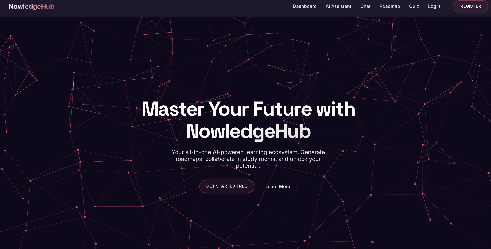

# NowledgeHub - AI Learning Platform 🚀

**NowledgeHub** is an AI-powered study platform. It combines a Gemini study assistant, question answering over your own PDFs (RAG), web research reports, AI quizzes and roadmaps, and real-time study rooms.

🚀 **Try Live:** [Frontend](https://nowledgehub.vercel.app/) | [Backend API](https://nowledgehub.onrender.com/)



---

## ✨ Features

### 🧠 AI Assistant
- **AI Chat with memory**: Gemini 3.6 Flash answers study questions and sees the last 10 messages of the conversation.
- **PDF RAG**: upload PDFs and ask questions about them. Answers are grounded in your documents and cite the **file and page number**. Each user only searches their own documents; you can pick one document or search all of them, and remove documents you no longer need.
- **Deep Research**: runs an advanced Tavily web search (top 5 sources) and has Gemini write a structured Markdown report with numbered citations. The Sources list is built from the real search results. Reports can be downloaded as `.md`.
- **History**: every conversation is saved per mode and can be reopened or deleted from the History sidebar.

### 📚 Learning tools
- **AI Quiz Generator**: 5 multiple-choice questions on any topic (Gemini 3.5 Flash-Lite, JSON output validated on the server).
- **AI Roadmap Generator**: a 4-step learning plan with durations and resources.

### 🤝 Collaboration
- **Global study chat** and **private study rooms** joined with a 6-character code, powered by Socket.IO.
- Every socket connection is authenticated with the user's JWT, and only room members can read or send messages in a room. Messages are kept for 30 days.
- Study timer in each room.

### 🔐 Security
- Email verification with a 6-digit code (stored hashed, expires in 10 minutes, max 5 attempts, resend with a 60-second cooldown).
- Passwords hashed with bcrypt; 7-day JWT sessions (HS256).
- Rate limiting on all API routes, stricter limits on login/sign-up and on AI and upload routes.
- Input validation on every route (blocks NoSQL injection), Helmet security headers, CORS restricted to the frontend.

---

## 🛠️ Tech Stack

**Frontend:** React 19, React Router 7, Axios, socket.io-client, react-markdown + remark-gfm, react-syntax-highlighter, react-hot-toast, Vanta.js. Pages are lazy-loaded.

**Backend:** Node.js 20+, Express 5, MongoDB Atlas + Mongoose, Socket.IO, JWT + bcryptjs, Multer + pdf-parse, Nodemailer, express-rate-limit, Helmet.

**AI:**
| Purpose | Model / tool |
|---|---|
| Chat, PDF answers, research reports | `gemini-3.6-flash` |
| Quiz and roadmap JSON | `gemini-3.5-flash-lite` |
| Embeddings | `gemini-embedding-2` (768 dimensions) |
| Gemini SDK | `@google/genai` (official Google Gen AI SDK) |
| Text splitting + vector store | LangChain.js (`RecursiveCharacterTextSplitter`, `MongoDBAtlasVectorSearch`) |
| Vector database | MongoDB Atlas Vector Search (cosine, filtered by user) |
| Web search | Tavily |

All models can be changed with environment variables (see `backend/.env.example`).

### How the PDF RAG pipeline works
1. **Extract**: pdf-parse reads the PDF page by page (scanned PDFs with no text are rejected).
2. **Chunk**: each page is split into 800-character chunks with 200 characters of overlap; every chunk keeps its file name and page number.
3. **Embed**: chunks are embedded with `gemini-embedding-2` in batches of 100 and stored in Atlas with the owner's user ID. Re-uploading a file replaces the old copy.
4. **Retrieve**: the question is embedded and `$vectorSearch` returns the top 5 chunks **from that user's documents only**; chunks below a 0.5 similarity score are dropped.
5. **Generate**: Gemini answers only from those excerpts and cites `(file, p. N)`.

Each stage is timed and stored in MongoDB (kept 30 days). `GET /api/study/metrics` reports average, median (p50) and p95 times for the last 24 hours.

### Reliability
- Every Gemini call has a 60-second timeout and is retried up to 3 times on 429/5xx/network errors with exponential backoff and jitter (1 s, 2 s, 4 s ceilings). Errors like an invalid API key are not retried and return a clear message.
- Embedding results are checked: a failed or incomplete embedding stops the upload instead of storing unusable vectors.

---

## 🚀 Getting Started

### Prerequisites
- Node.js **20+**
- A MongoDB Atlas cluster (Vector Search is available on the free tier)
- A Gemini API key from [Google AI Studio](https://aistudio.google.com/apikey)
- A Tavily API key (for Deep Research)
- A Gmail account with an App Password (for verification emails)

> **Gemini API keys:** Google now rejects requests from *unrestricted* standard API keys. New keys created in AI Studio are auth keys and work out of the box. If you have an old key, either restrict it to the Gemini API in AI Studio or create a new one. Run `npm run check:gemini` to test your key.

### 1. Backend
```bash
cd backend
npm install
cp .env.example .env      # then fill in the values
npm run check:gemini      # tests your API key and the configured models
npm run setup:rag         # creates/updates the Atlas vector index (run once, and again after changing the embedding model)
npm run dev               # http://localhost:5000
```

`setup:rag` creates the vector index `default` on `vectordocuments` with the right dimensions and the `userId`/`source` filter fields. If you had PDFs indexed with an older embedding model, run `npm run setup:rag -- --purge` to remove the old chunks and re-upload those PDFs.

Without `EMAIL_USER`/`EMAIL_PASS` (development only), verification codes are printed in the backend console.

### 2. Frontend
```bash
cd frontend
npm install
cp .env.example .env      # REACT_APP_API_URL=http://localhost:5000
npm start                 # http://localhost:3000
```

### 3. Tests
```bash
cd backend
npm test
```
Covers retries/backoff, the Gemini wrapper (request format, error handling, embedding batching), quiz/roadmap validation, page-aware PDF parsing, authentication, input validation, rate limiting, CORS and socket authentication.

---

## 🌐 Deployment

### Frontend (Vercel)
- Root directory: `frontend`
- Environment variable: `REACT_APP_API_URL=https://nowledgehub.onrender.com`
- `vercel.json` rewrites all routes to `index.html` so page refreshes work.

### Backend (Render)
- Root directory: `backend`, build command `npm install`, start command `npm start`
- Add every variable from `.env.example`. Set `FRONTEND_URL` to your Vercel URL (comma-separate several URLs).
- Allow Render's IPs (or `0.0.0.0/0`) in MongoDB Atlas Network Access.
- Run `npm run setup:rag` once (locally, pointed at the production `MONGO_URI`) to create the vector index.

---

## 📡 API Overview
| Area | Endpoints |
|---|---|
| Auth | `POST /api/auth/register`, `/verify`, `/resend-otp`, `/login`, `GET /api/auth/me` |
| AI | `POST /api/ai/chat`, `/quiz`, `/roadmap`, `/research`; `GET/DELETE /api/ai/history[/:sessionId]` |
| PDF study | `POST /api/study/upload`, `/ask`; `GET /api/study/documents`; `DELETE /api/study/documents/:source`; `GET /api/study/metrics`, `/verify-index` |
| Rooms | `POST /api/chat/create`, `/join`; `GET /api/chat/recent/:roomId` |
| Sockets | `joinRoom`, `sendMessage`, `leaveRoom` → `receiveMessage` |

All routes except sign-up/login and health checks require `Authorization: Bearer <token>`.

---

## 🔮 Future Improvements
- [ ] Stream AI answers token by token
- [ ] Background queue for very large PDF uploads
- [ ] OCR for scanned PDFs
- [ ] File sharing in study rooms

---

Made by Swati Shah!
